  

I turn paper and Excel work into code: customs PDFs into 1C documents, Telegram bots into databases on a server. I write it, test it and keep it running myself. Most of this lives in private repositories, so here is what it does.

## Selected work

| Project | What it does |
| :-- | :-- |
| **Davomat** Face ID attendance | Hikvision terminals write straight to the database. Handles weekly, cyclic and night shifts, timesheets, payroll and Telegram reports. Runs at two companies. FastAPI, React, SQLite |
| **1C automation** Scheduled scripts | Collects customs PDFs every morning, updates Excel registers and enters documents into 1C, so nobody retypes them by hand. Python, 1C, PowerShell |
| **[Andijon Sale](https://t.me/AndijonSaleBot)** Telegram Mini App store | Sections, stock by size and order numbers. Stock returns on its own when an order is cancelled. 740 products, managed by the owner from an admin panel. aiogram, Mini App, SQLite |
| **Live Uzbek subtitles** Desktop app, local AI | Captures computer audio and shows translated subtitles over the screen with about half a second of delay. Also makes `.srt` files from video. Whisper, NLLB-200 |
| **CS2 fragmovies** Video pipeline | Scans demos for multi-kill rounds, drives CS2 and OBS to record in 4K, then cuts the clips to the beat. Python, OBS, FFmpeg |
| **Baliqchi GES in 4K** AI video on a local GPU | Turned ordinary phone photos into moving 4K shots with Qwen Edit, Wan 2.2 and ESRGAN, all on a home RTX 3080. ComfyUI, Wan 2.2 |

## Stack

**Bots and web**

       

**Automation and servers**

   

**AI and video**

   

**Android**, where I started in 2022. My public repositories are from that time.

   

## Contact

   

 

